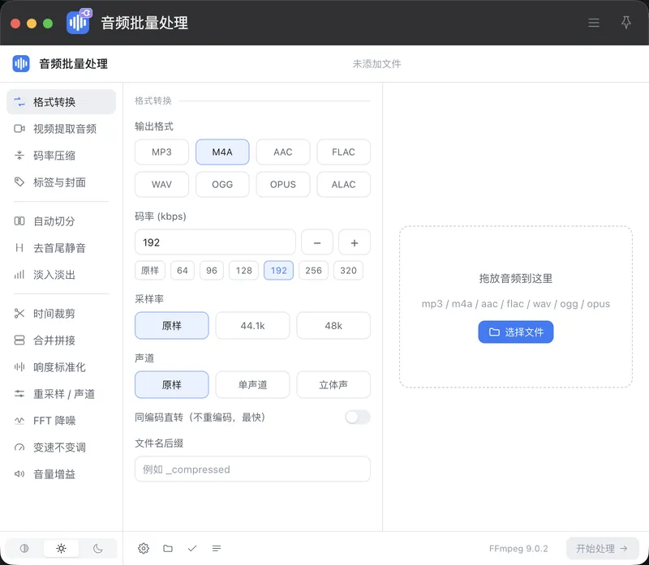

# 音频批量处理

一个 [uTools](https://www.u-tools.cn) 插件：把长音频、音声、ASMR 素材批量转码、统一响度、写标签封面、按静音切段。**复用 uTools 宿主内置的 ffmpeg，插件本身不携带任何二进制**。



## 功能

**A 转码**

| 功能 | 说明 |
|---|---|
| 格式转换 | mp3 / m4a / aac / flac / wav / ogg / opus / alac 互转，可指定码率、采样率、声道；同编码可直转不重编码 |
| 视频提取音频 | 从 mp4 / mkv / mov / webm / avi 等视频里取出音轨（画面字幕丢弃），可重编码成任意音频格式或直接复制音轨；多音轨视频支持**逐条导出**（`原名_1/2…`）或**混合成一条**（`amix` + 限幅，需重编码） |
| 码率压缩 | 保持原格式，降码率或调 FLAC 压缩等级；码率可选「原样」按源文件自动取值 |
| 标签与封面 | 批量写 title / artist / album / genre / 年份 / 备注，嵌入新封面；可勾选「同时导出原封面」把内嵌封面存成 jpg / png。打开这一栏时会从列表第一个文件读一次标签自动填入 |

**B ASMR 专用**

| 功能 | 说明 |
|---|---|
| 自动切分 | 按静音自动切（先探测再逐段导出）、按时长均分、按份数均分；每段带微淡入淡出消爆音 |
| 去首尾静音 | 掐掉开头结尾空白，中间静音保留 |
| 淡入淡出 | 首尾加包边 |

**C 音频工程**

| 功能 | 说明 |
|---|---|
| 时间裁剪 | 按起点+时长或起点+终点截取，可加淡入淡出 |
| 合并拼接 | 多文件按顺序合成一个；参数一致自动流复制，否则重编码 |
| 响度标准化 | 按 LUFS 统一响度，可直接输入或用 `−` / `+` 调；下方 -14 / -16 / -18 / -20 / -23 一键套用，提示行会跟着说明该档用途。默认两遍法（先测量再套用），音声建议 -18 LUFS |
| 重采样 / 声道 | 统一到 44.1k / 48k、单声道 / 立体声，方便合并与入库 |
| FFT 降噪 | `afftdn` + 高低通，三档强度 |
| 变速不变调 | 0.5x–2x，可直接输入倍率或用 `−` / `+` 按 0.05 微调，下方一键套 0.5x / 0.75x / 1x / 1.25x / 1.5x / 2x；`atempo` 串联保音高 |
| 音量增益 | ±30dB，超过 +6dB 自动挂限幅器 |

**D 辅助**：频谱图 / 波形图导出。

切分产物命名：

```
{原名}_{序号:03d}_{开始mm-ss}_{结束mm-ss}.{ext}
ASMR补档_太夯了超耐久_001_00-00_12-34.flac
```

## 快速开始

```bash
pnpm install
pnpm dev           # 开发服务器，端口 5180（vite.config.js 里固定，strictPort）
pnpm build         # 产物到 dist/，并做四项校验
```

装进 uTools：

1. 打开 uTools → **插件应用市场** → 安装「uTools 开发者工具」
2. 开发者工具 → 新建项目 → 填名称/描述/平台/开发者名
3. 选「安装（开发模式）」指向本仓库根目录（`plugin.json` 所在处），`development.main` 已配好 `http://127.0.0.1:5180`
4. 搜索「音频批量处理」进入，或直接把音频 / 视频文件拖到 uTools 图标上

发布：`pnpm build` 后，用开发者工具选择 `dist/` 目录打包 `.upx`。

> ⚠️ 端口固定 **5180**（`vite.config.js` 里 `strictPort: true`，被占用会直接启动失败而不是自动换端口）。真要换端口，**两处都要改**：`vite.config.js` 的 `server.port` 和 `plugin.json` 的 `development.main`，漏一个就是白屏。

## 用法

- **拖入**：把文件或整个文件夹拖到插件窗口，或拖到 uTools 图标；文件夹会递归展开（音频与视频都会收进来，视频只在「视频提取音频」里有意义）
- **选功能**：左侧导航点一个功能，中间调参数
- **应用设置**：点底部齿轮 ⚙ 打开，里面有 ——
  - **输出位置**：四选一 —— **源文件同级 / 下载目录 / 桌面 / 指定目录**，弹窗里会显示解析后的实际路径；默认不覆盖同名文件，冲突自动加 ` (1) (2)`
  - **任务并行数**：1–4，默认 2；每个 ffmpeg 会吃满所有核心，机器弱就调到 1
  - **侧边栏显示**：逐个功能勾选，取消勾选的功能不再出现在左侧导航（功能本身和对应的 MCP 工具仍可用）。「格式转换」「视频提取音频」是常驻功能，始终显示、不在勾选列表里；频谱 / 波形图默认收起，需要时勾上
- **开始处理**：默认 **2 个任务并行**（应用设置里可调 1–4，单个任务内部仍按顺序跑），进度、速度、剩余时间在右侧任务区；跑动中点「取消」会立刻收尾，并把本任务已产出的半成品删掉
- **常用艺术家**：「标签与封面」里的艺术家输入框下方会列出最近用过的 5 个（执行后自动记录，去重、最新的在前），点一下直接填入
- **主题**：左下角三档 —— 跟随系统 / 白天 / 黑夜，选择会记住（存在插件配置里）
- **频谱 / 波形预览**：这一栏是独立的整幅查看器（不分左右栏）。文件一拖进来就自动渲染一张采样预览，**不产生任何文件**；想留档再点「生成完整图」。顶部可切换频谱/波形与文件，右侧「作用说明」可收起

## 作为 AI 工具使用

装了插件并开启 **uTools 设置 → AI 设置 → MCP 服务** 后，13 个工具会通过 MCP 暴露给 AI Agent（默认 `http://127.0.0.1:3501/mcp`）。

| 工具 | 用途 |
|---|---|
| `audio_info` | 读元信息（时长/码率/采样率/声道/位深/标签/有无封面） |
| `audio_convert` | 格式转换、码率压缩、重采样 |
| `audio_extract` | 从视频里提取音轨，`trackMode` 可选 first / all / mix |
| `audio_clip` | 时间裁剪 |
| `audio_merge` | 多文件合并 |
| `audio_edit` | 变速 + 增益 + 淡入淡出（一条滤镜链） |
| `audio_normalize` | LUFS 响度标准化 |
| `audio_denoise` | 降噪 |
| `audio_metadata` | 写标签 / 嵌封面 / 导出原封面 |
| `audio_cover` | 提取封面 |
| `audio_trim_silence` | 去首尾静音 |
| `audio_split` | 按静音 / 时长 / 份数切分 |
| `audio_visualize` | 频谱图、波形图 |

MCP 调用会自动拉起插件（即使窗口没打开），长任务通过 `ctx.sendProgress` 上报进度。返回结构是 `{ results[], succeeded, failed, total }`，单个文件失败不会中断整批，只在对应项里带 `error`。

## 安全边界

插件会调用 ffmpeg、读写本地文件，因此把「渲染层能指挥 preload 做什么」收紧到了下面几条（对应插件市场审核意见）：

- **路径白名单（会话级）**：只有用户**亲手选择**（打开文件对话框 / 选目录）、**拖入**、或**从 uTools 文件关联进入**的路径会被登记；其余路径一律拒绝。删文件、移动文件、读图片、递归列目录、探测文件都要先过这道校验。
- **删除与覆盖只认本次产出**：只有「本次会话里 ffmpeg 真正写出的文件」和插件临时目录里的文件可以删；目标已存在时，即便打开「覆盖同名文件」也不会覆盖非本次产出的文件。
- **ffmpeg 参数白名单**：`run` / `runCapture` 收到的参数数组会逐个 token 校验——只认已登记的 flag 与取值范围，输入必须是已授权文件、输出必须落在已授权目录，`http(s)://`、`pipe:`、`movie=` 滤镜、`-f lavfi`、未知 flag 等一律拒绝。
- **ffmpeg 可执行文件校验**：切换自定义 ffmpeg 时要求文件名是 `ffmpeg` / `ffprobe`，且 `-version` 输出确实以 `ffmpeg version N` 开头、主版本 ≥ 4；失败直接拒绝，不会写进配置。
- **外链白名单**：设置页里的「下载」只放行 `https` 且主机为 evermeet.cx / gyan.dev / ffmpeg.org 的链接。
- **配置分两处存**：输出模式、后缀、响度目标、主题等跨机偏好存在 uTools 同步库；`ffmpegPath`、`ffmpegExtras`、自定义输出目录这类本机绝对路径存在插件本地文件，不随账号同步。

对 AI（MCP）同样生效：`audio_*` 工具只能处理**用户已经在插件界面里添加过的文件**，输出目录限「源文件同级 / 下载目录 / 桌面 / 用户选过的目录」；传其它路径会返回明确的「未授权」错误，而不是静默失败。

## 实现要点

- **ffmpeg 有两条后端，优先用系统装的那个**。`preload/lib/binaries.js` 按「设置里的自定义路径 → `$PATH` → 常见安装目录」找 `ffmpeg`，要求主版本 ≥ 4；找到就用 `child_process.spawn` 直接跑（自带 `-progress pipe:1` 解析进度）。找不到才退回 `utools.runFFmpeg()`（宿主内置，macOS 上是 7.1）。
- **ffprobe 同理**，优先取与 ffmpeg **同目录**的那个。有 ffprobe 时探测走 `-print_format json`，字段可靠且快（本机实测 20–30ms/文件）；没有就退回解析 `ffmpeg -i` 的 stderr。
- **插件本身不携带任何二进制**，构建会拒绝产物里出现 ffmpeg/ffprobe。
- **preload 是 CommonJS**，唯一出口 `window.audioServices`，渲染层碰不到 `fs` / `child_process`。
- **GUI 与 MCP 同源**：两者都走 `src/core/features.js` 的 `build()`，参数只在 `src/core/args.js` 生成一份。

**切换 / 查看 FFmpeg**：点底部工具栏右下角的版本号（如 `FFmpeg 9.0.2`）打开设置弹窗 ——

- 列出这台机器上扫到的所有 ffmpeg（各自版本、有没有配套 ffprobe），点「使用」即可切换
- 可以手动填路径（可执行文件或它所在目录），失效会自动回退到自动探测并给出提示
- 想强制用宿主内置的就选那一项，想要最新版就选系统装的
- 一个都没扫到时会给出下载地址（evermeet.cx / gyan.dev / 官方页）和 `brew install ffmpeg` 这类命令

底部那一排小图标（应用设置 / 打开目录 / 打开最近产出 / 清任务）悬停也有说明。

## 目录

```
plugin.json                 uTools 清单（main / logo / preload / features；tools 由构建生成）
preload/
  index.js                  装配 window.audioServices
  lib/probe.js              stderr 解析元信息
  lib/ffmpeg.js             进程表 / 环形缓冲 / quit→kill
  lib/fsx.js                文件操作（读 / 写 / 列目录，全部先过白名单）
  lib/exts.js               扩展名常量，数据来自 shared/exts.json
  lib/config.js             设置持久化
src/
  core/args.js              所有 ffmpeg 参数的唯一真相
  core/features.js          功能定义：字段 + build()，GUI 与 MCP 共用
  core/paths.js             输出命名 / 重名检测（业务规则，前端持有，唯一实现）
  core/queue.js             2 路并行队列、op 权重进度、取消重试
  core/mcp.js  register.js  13 个 MCP 工具与注册
  core/store.js  ingest.js  状态与文件载入
  panels/ components/        UI
shared/exts.json            音频 / 视频扩展名（preload 与前端读同一份）
scripts/build-plugin.mjs    构建校验
doc/                        修复日志（索引见 doc/README.md）
```

## 已知限制

- `.aac` 是 ADTS 裸流，**不能存任何标签或封面**。插件默认输出 m4a（`-c copy` 零转码，顺带修好时长）；真的要输出 ADTS 会给出警告。
- 写标签即使 `-c copy` 也会重写整个文件，2 小时 flac 大约几秒。
- 视频提取音频默认只取**第一条**音轨；多音轨视频把「音轨处理」改成「逐条导出」或「混合一条」。混合用 `amix` 按原音量相加（`normalize=0`）再挂 `alimiter`，如果两条轨本身都很响仍可能听感偏挤，需要精确响度就用「响度标准化」再过一遍。「直接复制音轨」要求源编码与目标容器兼容，不兼容时 ffmpeg 会直接报错，换成重编码即可。
- 文件列表里的码率：音频文件显示整文件码率；视频文件显示**音轨**码率（前缀「音频」），容器总码率放在悬停提示里——视频的总码率含画面，拿来判断音频质量会高得离谱。
- FLAC 的 concat 流复制会写出错误的 STREAMINFO 总采样数（只有第一段），所以 FLAC 合并一律重编码。
- `loudnorm` 内部会把音频升到 192kHz，插件已强制拉回 48kHz。
- 降噪用 `afftdn`（纯滤镜）；`arnndn` 需要外挂模型文件，宿主不提供，因此没有采用。
- 没有自动更新器，升级靠重新打包安装。

## 构建校验

除了「工具名与实现一一对应」「产物不含 ffmpeg 二进制」「总体积 < 3MB」，还会检查 `preload/index.js` 已接入 `lib/guard`、参数白名单模块确实被打进产物——防止出现「前端改了、preload 忘了拷」的版本错配。


`pnpm build` 会断言：

- `src/core/tool-schemas.js` 的 `TOOL_DEFS` 与 `src/core/tool-names.js` 完全一致，每个工具都有 `description` 和 object 类型的 `inputSchema`，`required` 里的字段必须已声明；`dist/plugin.json` 的 `tools` 就是由它生成的（根 `plugin.json` 里写了 `tools` 会直接构建失败）
- 产物里没有 `development` 字段
- 产物里没有 ffmpeg / ffprobe 二进制
- 产物总大小 < 3MB（当前 0.38MB）
- `index.html` 用相对路径引用资源

`pnpm check` 另有一组不依赖测试框架的断言脚本（失败即非零退出，构建前先跑一遍）：

- `scripts/check/guard.test.mjs`——路径白名单：未授权的读 / 写 / 删 / 改全部拒绝，只授权直接父目录
- `scripts/check/api-surface.test.mjs`——preload 对外接口面：页面拿不到写白名单的接口（`grantPaths` / `grantDir` 这类名字以及任何 `grant*` / `allow*` 都不允许存在），导出键集合必须与脚本里的 `EXPECTED_KEYS` 逐字一致。新增 preload 接口要显式补进这个快照
- `scripts/check/args.test.mjs` + `features-args.test.mjs`——ffmpeg 参数白名单：17 个功能的真实参数全部过一遍，注入型参数必须被拒
- `scripts/check/paths.test.mjs`——输出命名规则的 golden 断言（17 例），锁死用户最终看到的文件名
- `scripts/check/binaries.test.mjs`——ffmpeg 探测、文件名与 `-version` 横幅校验
- `scripts/check/ffmpeg-smoke.mjs`——真实 ffmpeg 端到端冒烟（本机没有 ffmpeg 时跳过）

> ⚠️ **新增 ffmpeg flag 或 `-af` 滤镜时，必须同时登记进 `preload/lib/argswhitelist.js`**（flag 白名单 + 取值规则 + 滤镜名），然后跑 `node scripts/check/features-args.test.mjs`。白名单默认拒绝未登记项，漏登记不会在构建期报错，只会让功能在运行期直接失败——所以这是硬要求，不是建议。

提交前可安装官方自检 skill，让 AI 按审核标准先自查一遍：npx skills add uTools-Labs/utools-plugin-selfcheck-skill
